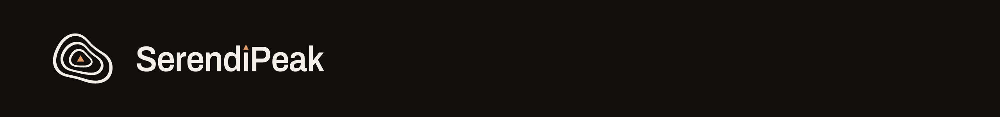
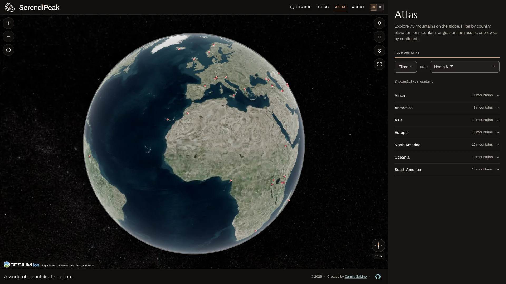
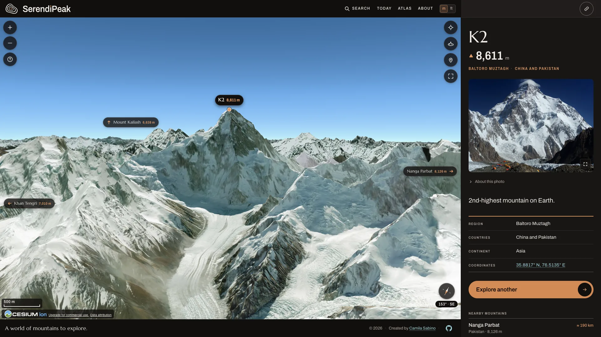
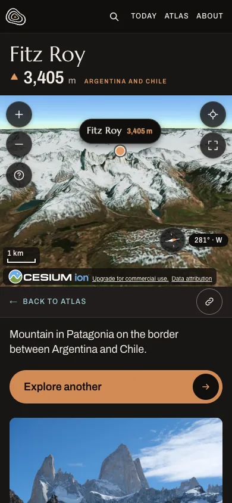
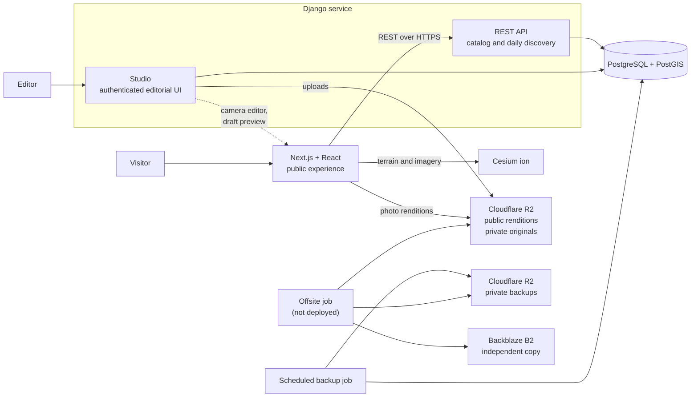

**A world of mountains to explore.**

SerendiPeak is a mountain discovery and exploration experience. Explore the world's mountains through an interactive 3D globe, curated geography, and real photography, with one featured mountain every day.

[**Explore SerendiPeak →**](https://serendipeak.com) &nbsp;·&nbsp; [](https://github.com/camilasabino/serendipeak/actions/workflows/ci.yml)



## What it does

Every day the site features one mountain from a curated catalog, inviting visitors to explore the landscape and learn about the place behind it.

- **Discover today's mountain.** A daily selection, chosen per UTC date, shared by every visitor and kept across restarts.
- **Explore another.** Travel to a different mountain without leaving the 3D experience.
- **Browse the atlas.** Every published mountain as a marker on an interactive globe at [/atlas](https://serendipeak.com/atlas), with a list grouped by continent. Filter by country, elevation band or mountain range and sort by name or elevation: the list narrows to one sorted set of matches and the globe keeps only their markers; a country or range also turns the globe to frame them. Nearby markers are decluttered, and a chooser opens where several overlap.
- **Search by name.** Find a mountain from any page, ignoring case and accents. Search is keyboard operable and announces its results.
- **Explore the terrain.** Navigate a Cesium-powered 3D scene framed by a curated, mountain-specific camera, with compass, scale bar, zoom, reset and fullscreen controls. A 360° orbit circles the summit, and one switch hides or shows the mountain markers on the atlas, today's mountain and every mountain page. Every control explains itself in a tooltip, and a tabbed **How to navigate** guide covers mouse, touch and the controls. Visitors who prefer reduced motion get direct moves instead of animated flights, and no orbit or globe rotation.
- **Choose your units.** Switch between metric and imperial from the header; elevations, markers, the scale bar and the atlas elevation bands follow, and the choice is remembered in the browser.
- **Understand the geography.** See elevation, coordinates, continent, countries, and the mountain's region hierarchy, with a short summary and, where one is written, a longer description that expands in place.
- **See the mountain beyond the map.** View a real photograph with its author, license, and source.
- **Share a place.** Each mountain has a permanent URL such as [Aconcagua](https://serendipeak.com/mountains/aconcagua). If a mountain's slug changes, its former address redirects permanently to the new one. Pages carry canonical URLs and social preview metadata, and a share control uses the native share sheet or copies the link.



The public experience is open without an account and adapts to small screens:

<p align="center">
  
</p>

<sub>Screenshot credits. Terrain: Cesium World Terrain (data available from the U.S. Geological Survey, © CGIAR-CSI, produced using Copernicus data and information funded by the European Union - EU-DEM layers, data available from Land Information New Zealand, data available from data.gov.uk, data courtesy Geoscience Australia). Imagery: Cesium World Imagery (© 2026 Microsoft Corporation, © Mapbox, © Maxar, ©CNES (2026) Distribution Airbus DS, Earthstar Geographics SIO), both streamed through Cesium ion. Photographs: K2 by Zacharie Grossen and Fitz Roy by Sebgigon, both [CC BY-SA 4.0](https://creativecommons.org/licenses/by-sa/4.0). Credits and terms in [docs/media/README.md](docs/media/README.md#credits-and-rights).</sub>

## Editorial workflow

Behind the public site is an authenticated editorial workspace, the **Studio**, built with Django. Editors maintain mountain records and the region taxonomy, curate photographs, preview drafts, and adjust a mountain's saved viewpoint in a visual **Camera Editor**. The editor renders the same 3D scene as the public site; saving a camera goes through an Editor-only confirmation in the Studio. Publication is separate from drafting, so unpublished changes never appear on the public site. The [developer reference](docs/engineering/developer-reference.md#editorial-studio) documents the Studio and the camera flow.

## Architecture



- **Catalog and discovery.** PostgreSQL/PostGIS is the source of truth. The daily mountain is a deterministic function of the UTC date and is persisted, so every visitor gets the same answer.
- **Geographic data.** PostGIS stores summit locations; continents, countries and a region hierarchy of any depth are first-class data.
- **Photograph delivery.** The Studio stores each upload as a private original plus public renditions. The public API only derives URLs from stored keys and makes no outbound requests.
- **3D scene lifecycle.** Navigating between mountain pages reuses one Cesium viewer instead of recreating its WebGL context for every destination.
- **Publishing.** Drafts are invisible to the public API. Draft previews use signed, time-limited, single-mountain tokens.
- **Search engines.** The web app serves a dynamic `sitemap.xml` and `robots.txt` built from the public mountain index, so only published mountains are listed.
- **Operations.** Web and API run as separate Docker images on Railway. A scheduled service dumps the database to private storage. A second job, defined in the repository with its own image and runbook, copies the media and dumps to another provider; no such service is deployed in production yet.

### Engineering decisions

- **Ports and adapters in the backend.** `catalog` and `discovery` hold entities, use cases and pure rules, and import no Django, DRF or database code. Persistence, HTTP and CLI are adapters, and architecture tests fail when an import crosses the boundary. Details in the [developer reference](docs/engineering/developer-reference.md).
- **Invariants live in the database.** Constraints, `PROTECT` foreign keys and triggers guard what must never break: immutable daily discoveries, acyclic and immutable regions, and photograph keys tied to their checksum.
- **Idempotent daily discovery.** The first request of a UTC date inserts with `ON CONFLICT DO NOTHING` and re-reads the stored row, so concurrent requests converge without locks or retries.
- **Immutable media.** Photographs are content-addressed by SHA-256 and served with long-lived immutable caching; changing a rendition parameter means a new rendition version, never overwritten bytes.
- **Contract-first API.** The response shapes of the original implementation are kept as frozen fixtures in `contracts/v1/`, checked byte for byte, and the API tests compare every response against them.
- **Hardened by default.** Studio access is deny-by-default and role-based, sign-in is throttled, cookies are scoped and `HttpOnly`, and production refuses to start with unsafe proxy, host or media settings. The web build fails if test-only diagnostics reach the production bundle.

## Tech stack

| Area | Technology |
| --- | --- |
| Web | Next.js 16 (Pages Router), React 19, TypeScript, CSS Modules |
| 3D visualization | CesiumJS, Cesium ion, WebGL |
| API and editorial | Python 3.13, Django 6, Django REST Framework, GeoDjango |
| Data | PostgreSQL 18, PostGIS |
| Media | Cloudflare R2, Pillow |
| Infrastructure | Railway, Docker, GitHub Actions |
| Quality | Vitest, Playwright, pytest, Ruff, ESLint, Prettier |

## Repository structure

```text
serendipeak/
├── apps/
│   └── web/             # Next.js app, Cesium scene, UI and browser tests
├── services/
│   ├── api/             # Django API, domain logic, Studio and migrations
│   ├── backup/          # Scheduled PostgreSQL backup container
│   └── offsite-backup/  # Scheduled offsite copy of media and database dumps
├── contracts/
│   └── v1/              # Frozen API contract fixtures
├── docs/
│   ├── engineering/     # Developer reference
│   ├── media/           # README screenshots
│   ├── brand/           # README masthead and social preview
│   └── deployment.md    # Production runbook
├── scripts/             # Contract and API checks, dev and catalog refresh commands
└── docker-compose.yml   # Local PostgreSQL/PostGIS
```

## Local development

**Requirements:** Node.js 24 (`.nvmrc`), Python 3.13, [uv](https://docs.astral.sh/uv/), Docker with Compose, and GDAL/GEOS for GeoDjango. On macOS, install GDAL with Homebrew (`brew install gdal`).

Create the local environment and start PostGIS:

```bash
cp .env.example .env
docker compose up -d --wait
```

In `.env`, set a development-only `PREVIEW_SIGNING_KEY` (at least 32 characters, different from `DJANGO_SECRET_KEY`) and, if your system cannot find GDAL and GEOS, the `GDAL_LIBRARY_PATH` and `GEOS_LIBRARY_PATH` overrides listed there. Never use production credentials in local environment files.

Start the API:

```bash
cd services/api
uv sync --locked
uv run --env-file ../../.env python manage.py migrate
uv run --env-file ../../.env python manage.py runserver
```

In a second terminal, create `apps/web/.env.local`:

```dotenv
NEXT_PUBLIC_API_BASE_URL=http://localhost:8000
NEXT_PUBLIC_CESIUM_ION_TOKEN=your-development-ion-token
```

Then run the web app:

```bash
cd apps/web
npm ci
npm run dev
```

Open `http://localhost:3000` (use `localhost`, not `127.0.0.1`, to match the API's CORS origin). The API listens on `http://localhost:8000`. Without a Cesium ion token the page still renders, but the 3D globe reports that it is unavailable. From the repository root, `npm run dev:start` starts PostGIS and restarts both dev servers, `npm run dev:restart` restarts only the servers, and `npm run dev:stop` stops them.

**Catalog availability.** The editable catalog, production database and original photographs are intentionally not part of this repository, so a fresh database has no published mountains. Automated tests use their own fixtures and stubs. To explore the product locally, create an editor with `manage.py create_editor <username>`, sign in to the Studio at `http://localhost:8000/studio/`, and add and publish a mountain, or load a catalog snapshot you supply. See the [developer reference](docs/engineering/developer-reference.md#catalog-snapshot) for the management commands.

## Testing and quality

Web checks, from `apps/web`:

```bash
npm run lint
npm run typecheck
npm test
npm run build
npm run check:production-gate
npm run test:ssr
npm run test:nogl
```

While working, run the focused specs for the code you touch. When you change a shared frontend component or contract (header, layout, brand, navigation, tokens), also run the specs that consume it indirectly, such as page and layout specs that assert on its markup. Lint and type checking do not replace tests.

The `ssr` and `nogl` Playwright projects assume a production build: `npm run test:ssr` and `npm run test:nogl` build first, and the build inlines `NEXT_PUBLIC_*` values, so a local `.env.local` with an ion token also breaks the `stageFailure` scenarios, which expect none. Pointing them at `next dev` reports failures that production does not have, because styles and route changes settle later there.

**WebGL smoke tests (optional, local).** A Playwright suite drives the real Cesium Viewer in Chromium. It covers the Viewer boot on the canonical camera, reuse and teardown across routes, atlas marker click versus drag, atlas filters and geographic framing, marker visibility, zoom and Reset, control tooltips and the navigation guide, metric and imperial units, the Camera Editor round trip and the summit marker layout. It never runs in CI and gates neither merging nor deployment.

```bash
npm run test:webgl        # development server: only the @lifecycle scenarios, under React Strict Mode
npm run test:webgl:prod   # production build: the whole smoke suite
```

Both commands copy the Cesium assets, start the stub API and a dedicated web server, and use one worker with a 90-second limit per test. Failed tests keep a Playwright trace under `apps/web/test-results`. Set `STUB_API_PORT` if port 8099 is taken. Because rendering is real, run them on a machine that stays awake. For substantial changes to Cesium, camera interaction, terrain, imagery or summit markers, also check the result by hand on a real device.

API checks, from `services/api` with local PostGIS running:

```bash
uv run ruff format --check .
uv run ruff check .
uv run --env-file ../../.env pytest
```

Frozen contract check, from the repository root:

```bash
npm ci
npm run contracts:verify
```

API tests run against a real PostGIS database rather than mocks. **CI** (GitHub Actions, on pull requests and pushes to `main`) runs commit-message, frozen-contract, API, web (lint, type check, unit tests, production build and gate, SSR and no-WebGL browser tests) and script checks. Real-WebGL coverage is limited to the optional local smoke tests above. Commits follow [Conventional Commits](https://www.conventionalcommits.org/) through Husky and commitlint.

## Deployment

The web app and the API run as separate Docker-based services on Railway, with PostgreSQL/PostGIS and a scheduled database backup job as further services. Cloudflare R2 serves the optimized public photographs, keeps originals in a private bucket and holds the database dumps. The offsite copy at Backblaze B2 has its own job and runbook; that job is not deployed in production yet.

See [docs/deployment.md](docs/deployment.md) for configuration, health checks, monitoring, backups, smoke tests (including sitemap and redirect checks) and recovery procedures.

## Documentation

| Document | Contents |
| --- | --- |
| [docs/engineering/developer-reference.md](docs/engineering/developer-reference.md) | Environment variables, API behavior, Studio, photograph media, catalog snapshots and web scripts |
| [docs/deployment.md](docs/deployment.md) | Production runbook |
| [docs/media/README.md](docs/media/README.md) | How the README screenshots and the social preview are produced |

## Data and attribution

SerendiPeak combines editorial mountain descriptions and geography with third-party terrain, imagery, photographs and geographic references. Photograph authorship, source and license details are shown in the product, and Cesium terrain and imagery remain subject to their providers' terms and attribution requirements. Third-party material is not covered by the repository license and keeps its own terms; the screenshots and the social preview carry the credits listed in [docs/media/README.md](docs/media/README.md#credits-and-rights).

Mountain records and photographs live in the production database and object storage, not in the source tree, and the original image files are not part of this repository.

## Status

Live at [serendipeak.com](https://serendipeak.com) and actively maintained. Features, data and internal interfaces may evolve.

## License

All rights reserved. No open-source license is granted for reuse or redistribution.
