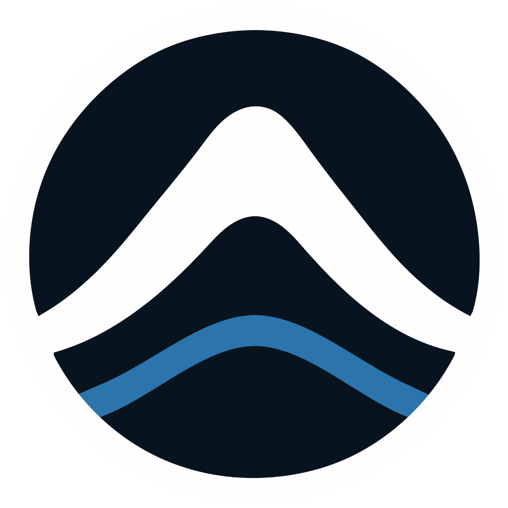
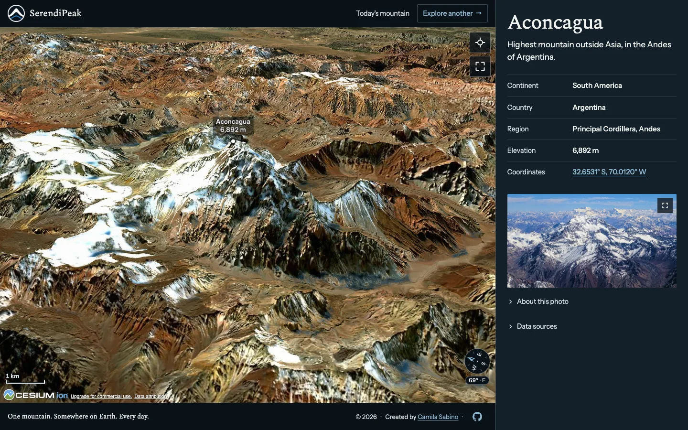
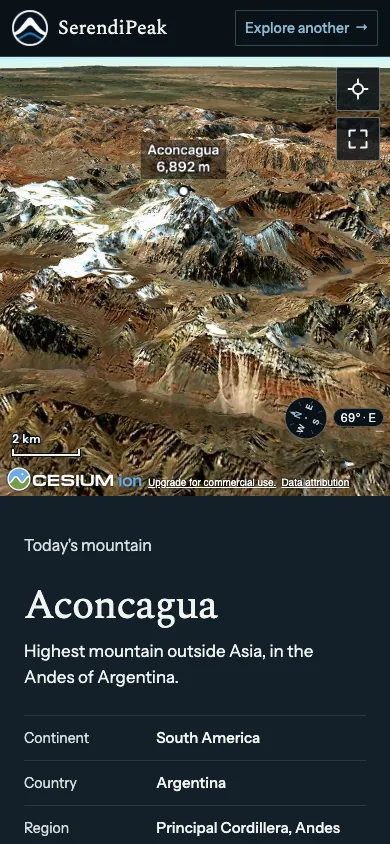
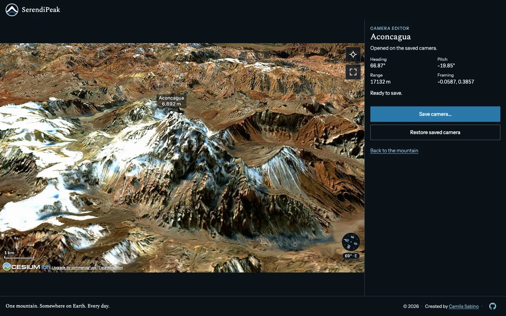
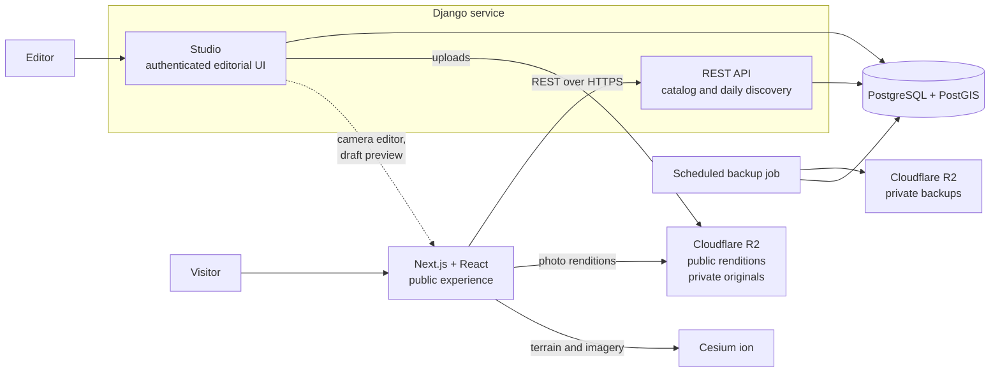

<p align="center">
  
</p>

<h1 align="center">SerendiPeak</h1>

<p align="center">
  <strong>One mountain. Somewhere on Earth. Every day.</strong><br />
  Explore the world's mountains through an interactive 3D globe, curated geography, and real photography.
</p>

<p align="center">
  <a href="https://serendipeak.camilasabino.dev"><strong>Explore SerendiPeak →</strong></a>
</p>

<p align="center">
  <a href="https://github.com/camilasabino/serendipeak/actions/workflows/ci.yml">
    
  </a>
</p>

<p align="center">
  <a href="docs/media/mountain-view.webp">
    
  </a>
</p>

## What it does

SerendiPeak is a mountain discovery experience. Every day it features one mountain from a curated catalog, inviting visitors to explore the landscape and learn about the place behind it.

- **Discover today's mountain.** A daily selection shared by every visitor and kept across restarts.
- **Explore another.** Travel to a different mountain without leaving the 3D experience.
- **Explore the terrain.** Navigate a Cesium-powered 3D scene with mountain-specific camera framing, compass, scale, reset, and fullscreen controls.
- **Understand the geography.** See elevation, coordinates, continent, countries, and the mountain's region hierarchy, with links to supporting geographic data.
- **See the mountain beyond the map.** View a real photograph with its author, license, and source.
- **Share a place.** Each mountain has a direct URL such as [Aconcagua](https://serendipeak.camilasabino.dev/mountains/aconcagua).

The public experience is open without an account and responds to small screens:

<p align="center">
  <a href="docs/media/mountain-view-mobile.webp">
    
  </a>
</p>

## Editorial workflow

Behind the public site is an authenticated editorial workspace, the **Studio**, built with Django. Editors maintain mountain records and the region taxonomy, curate photographs, preview drafts, and adjust a mountain's saved viewpoint in a visual **Camera Editor**. The editor renders the same 3D scene as the public site; saving a camera goes through an Editor-only confirmation in the Studio. Publication is separate from drafting, so unpublished changes never appear on the public site.

<p align="center">
  <a href="docs/media/camera-editor.webp">
    
  </a>
</p>

## Architecture



- **Catalog and discovery.** PostgreSQL/PostGIS is the source of truth. The daily mountain is a deterministic function of the UTC date and is persisted, so every visitor gets the same answer.
- **Geographic data.** PostGIS stores summit locations; continents, countries and a region hierarchy of any depth are first-class data.
- **Photograph delivery.** The Studio stores each upload as a private original plus public renditions. The public API only derives URLs from stored keys and makes no outbound requests.
- **3D scene lifecycle.** Navigating between mountain pages reuses one Cesium viewer instead of recreating its WebGL context for every destination.
- **Publishing.** Drafts are invisible to the public API. Draft previews use signed, time-limited, single-mountain tokens.
- **Operations.** Web and API run as separate Docker images on Railway. A separate scheduled service dumps the database to private storage.

### Engineering decisions

- **Ports and adapters in the backend.** `catalog` and `discovery` hold entities, use cases and pure rules, and import no Django, DRF or database code. Persistence, HTTP and CLI are adapters, and architecture tests fail when an import crosses the boundary. Details in the [developer reference](docs/engineering/developer-reference.md).
- **Invariants live in the database.** Constraints, `PROTECT` foreign keys and triggers guard what must never break: immutable daily discoveries, acyclic and immutable regions, and photograph keys tied to their checksum.
- **Idempotent daily discovery.** The first request of a UTC date inserts with `ON CONFLICT DO NOTHING` and re-reads the stored row, so concurrent requests converge without locks or retries.
- **Immutable media.** Photographs are content-addressed by SHA-256 and served with long-lived immutable caching; changing a rendition parameter means a new rendition version, never overwritten bytes.
- **Contract-first API.** The response shapes of the original implementation are kept as frozen fixtures in `contracts/v1/`, checked byte for byte, and the API tests compare every response against them.
- **Hardened by default.** Studio access is deny-by-default and role-based, sign-in is throttled, cookies are scoped and `HttpOnly`, and production refuses to start with unsafe proxy, host or media settings. The web build fails if test-only diagnostics reach the production bundle.

## Tech stack

| Area | Technology |
| --- | --- |
| Web | Next.js 16 (Pages Router), React 19, TypeScript, CSS Modules |
| 3D visualization | CesiumJS, Cesium ion, WebGL |
| API and editorial | Python 3.13, Django 6, Django REST Framework, GeoDjango |
| Data | PostgreSQL 18, PostGIS |
| Media | Cloudflare R2, Pillow |
| Infrastructure | Railway, Docker, GitHub Actions |
| Quality | Vitest, Playwright, pytest, Ruff, ESLint, Prettier |

## Repository structure

```text
serendipeak/
├── apps/
│   └── web/             # Next.js app, Cesium scene, UI and browser tests
├── services/
│   ├── api/             # Django API, domain logic, Studio and migrations
│   └── backup/          # Scheduled PostgreSQL backup container
├── contracts/
│   └── v1/              # Frozen API contract fixtures
├── docs/
│   ├── engineering/     # Developer reference
│   ├── media/           # README screenshots
│   ├── brand/           # Social preview
│   └── deployment.md    # Production runbook
├── scripts/             # Contract verification and API check tools
└── docker-compose.yml   # Local PostgreSQL/PostGIS
```

## Local development

**Requirements:** Node.js 24 (`.nvmrc`), Python 3.13, [uv](https://docs.astral.sh/uv/), Docker with Compose, and GDAL/GEOS for GeoDjango. On macOS, install GDAL with Homebrew (`brew install gdal`).

Create the local environment and start PostGIS:

```bash
cp .env.example .env
docker compose up -d --wait
```

In `.env`, set a development-only `PREVIEW_SIGNING_KEY` (at least 32 characters, different from `DJANGO_SECRET_KEY`) and, if your system cannot find GDAL and GEOS, the `GDAL_LIBRARY_PATH` and `GEOS_LIBRARY_PATH` overrides listed there. Never use production credentials in local environment files.

Start the API:

```bash
cd services/api
uv sync --locked
uv run --env-file ../../.env python manage.py migrate
uv run --env-file ../../.env python manage.py runserver
```

In a second terminal, create `apps/web/.env.local`:

```dotenv
NEXT_PUBLIC_API_BASE_URL=http://localhost:8000
NEXT_PUBLIC_CESIUM_ION_TOKEN=your-development-ion-token
```

Then run the web app:

```bash
cd apps/web
npm ci
npm run dev
```

Open `http://localhost:3000` (use `localhost`, not `127.0.0.1`, to match the API's CORS origin). The API listens on `http://localhost:8000`. Without a Cesium ion token the page still renders, but the 3D globe reports that it is unavailable.

**Catalog availability.** The editable catalog, production database and original photographs are intentionally not part of this repository, so a fresh database has no published mountains. Automated tests use their own fixtures and stubs. To explore the product locally, create an editor with `manage.py create_editor <username>`, sign in to the Studio at `http://localhost:8000/studio/`, and add and publish a mountain, or load a catalog snapshot you supply. See the [developer reference](docs/engineering/developer-reference.md#catalog-snapshot) for the management commands.

## Testing and quality

Web checks, from `apps/web`:

```bash
npm run lint
npm run typecheck
npm test
npm run build
npm run check:production-gate
npm run test:ssr
npm run test:nogl
npm run test:webgl
npm run test:webgl:prod
```

API checks, from `services/api` with local PostGIS running:

```bash
uv run ruff format --check .
uv run ruff check .
uv run --env-file ../../.env pytest
```

Frozen contract check, from the repository root:

```bash
npm ci
npm run contracts:verify
```

API tests run against a real PostGIS database rather than mocks, and the browser suites exercise real WebGL in Chromium. GitHub Actions runs commit-message, contract, API and web checks, including the browser suites, on pull requests and on pushes to `main`. Commits follow [Conventional Commits](https://www.conventionalcommits.org/) through Husky and commitlint.

## Deployment

The web app and the API run as separate Docker-based services on Railway, with PostgreSQL/PostGIS and the scheduled database backup as further services. Cloudflare R2 serves the optimized public photographs and keeps originals in a private bucket.

See [docs/deployment.md](docs/deployment.md) for configuration, health checks and recovery procedures.

## Documentation

| Document | Contents |
| --- | --- |
| [docs/engineering/developer-reference.md](docs/engineering/developer-reference.md) | Environment variables, API behavior, Studio, photograph media, catalog snapshots and web scripts |
| [docs/deployment.md](docs/deployment.md) | Production runbook |
| [docs/media/README.md](docs/media/README.md) | How the README screenshots and the social preview are produced |

## Data and attribution

SerendiPeak combines editorial mountain descriptions and geography with third-party terrain, imagery, photographs and geographic references. Photograph authorship, source and license details are shown in the product, and Cesium terrain and imagery remain subject to their providers' terms and attribution requirements. Third-party material is not covered by the repository license and keeps its own terms; the screenshots and the social preview carry the credits listed in [docs/media/README.md](docs/media/README.md#credits-and-rights).

Mountain records and photographs live in the production database and object storage, not in the source tree, and the original image files are not part of this repository.

## Status

Live at [serendipeak.camilasabino.dev](https://serendipeak.camilasabino.dev) and actively maintained. Features, data and internal interfaces may evolve.

## License

All rights reserved. No open-source license is granted for reuse or redistribution.
